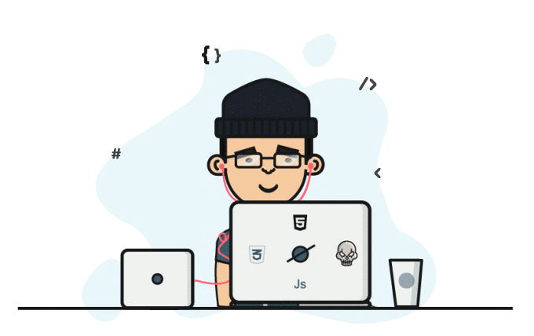

  <h1>Hi there, I'm Md Atamash</h2>

    

    

## About Me  
Driven MERN Full Stack Developer with a knack for building dynamic and efficient web applications. Proficient in both frontend and backend development, with a focus on crafting seamless user experiences and scalable solutions. Always eager to embrace challenges, learn new technologies, and contribute to impactful projects. Excited to explore opportunities that foster growth and innovation.

---

## 🌟 Highlights  
- 🔭 I’m currently working on **Full Stack Web Apps**  
- 🌱 I’m currently learning **Backend Development**  
- 👯 I’m looking to collaborate on **Exciting Projects**  
- 💬 Ask me about **Full Stack Web Development**  
- 📫 How to reach me:  
  - **Email**: [mdaltamash959@gmail.com](mailto:mdaltamash959@gmail.com)  
  - **WhatsApp**: [8298326987](https://wa.me/918298326987)  
- 😄 Pronouns: ...  
- ⚡ Fun fact: ...  

---

## 🛠 Skills  
- **Frontend**: HTML, CSS, JavaScript, React
- **Backend**: java,Node.js, Express  
- **Database**: MongoDB  
- **Version Control**: Git, GitHub  
- **Other Tools**: Postman, VS Code  

---

## 📂 Projects  
Check out my repositories to explore some of the projects I've worked on:  
- [**Maison Cafe**](https://maison-cafe-taupe.vercel.app/): It is basically Clone or added self idea for designing web page using HTML, CSS and JavaScript user friendly web you can explore the web on link given above.
- [**Altron Music App**](https://altron-music-app.vercel.app/): This web is basically i tried to make an user interface and how function any music app so this a music application or web you called this is made by using HTML CSS and JavaScript for functioning thee music and animations.

- For the rest Now i am working on a major projects that will appear here as soon as possible stay tuned.. Thank you...!

---

## 🌐 Let's Connect  
- **GitHub**: [Your GitHub Profile Link](https://github.com/pw033)  
- **LinkedIn**: [Your LinkedIn Profile Link](https://www.linkedin.com/in/md-altamash-b26947238/)  
- **Portfolio**: [Your Portfolio Link](https://pw033.github.io/My-Portfolio-Web/)  

---

Thank you for visiting my profile! Feel free to connect or drop a message anytime. 😊  

## 📫 Connect with Me

- [LinkedIn](https://www.linkedin.com/in/md-altamash-b26947238/)  
- [Twitter](https://x.com/Altamashwish)  
- [Portfolio](https://pw033.github.io/My-Portfolio-Web/)

---

"Building the future, one line of code at a time." 💻
